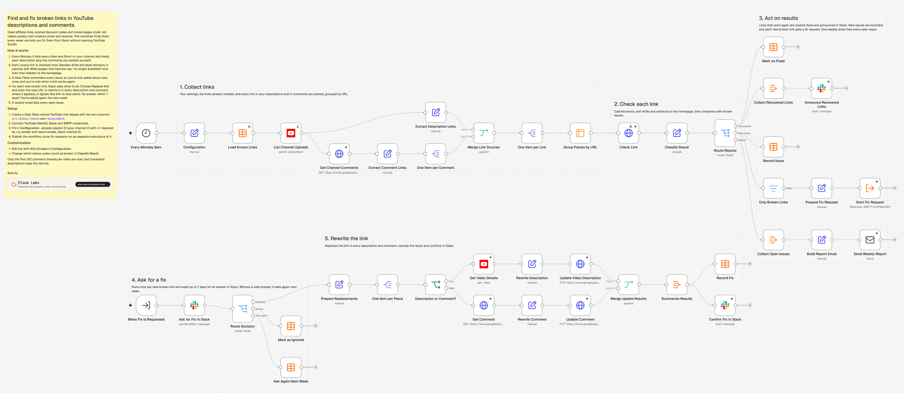

# Find and fix broken links in YouTube descriptions and comments with Slack approval

<!-- TODO(agent): one-sentence value proposition. See AGENTS.md. -->

## How it works

<!-- TODO(agent) -->

## Requirements

<!-- TODO(agent) -->

## Setup

<!-- TODO(agent) -->

## Import

<!-- TODO(agent) -->

## Customization

<!-- TODO(agent) -->

## Limitations

<!-- TODO(agent) -->

## License

MIT, see [LICENSE](LICENSE).

---

Built by [Cloud Labs](https://low-code-consultant.com)
