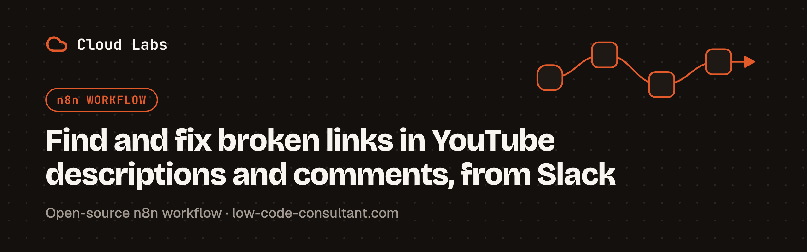

# Find and fix broken links in YouTube descriptions and comments with Slack approval

[](https://n8n.io)
[](LICENSE)

Dead affiliate links, expired discount codes and moved pages under old videos quietly cost creators clicks and revenue: this n8n workflow finds them every week and lets you fix them from Slack, without opening YouTube Studio.


## How it works

1. **Weekly scan.** Every Monday at 8am, the workflow lists every video and Short on your channel and reads each description, plus the comments you posted yourself.
2. **One check per link.** Each unique URL is requested once, like a browser would, however many videos use it. Besides 404s, server errors and dead domains, it catches soft 404s (pages that load but say "no longer available") and links that redirect to the homepage. 401, 403, 429, 503 and 999 responses are flagged "to verify", since they usually mean the site blocked the automated check.
3. **Data Table memory.** Every issue is stored in a Data Table, so you are only asked about new ones, and Slack tells you when a link works again.
4. **Fix from Slack.** For each new broken link, Slack posts a message with a **Fix this link** button. Choose **Replace link** and paste the new URL: the workflow rewrites it in every description and comment where it appears, without touching longer links that start the same way. Or choose **Ignore this link** to stop alerts for it. With no valid answer within 7 days, the link is asked about again the following week.
5. **Weekly email.** One email lists every open issue, broken links first, and points you to the Slack requests to fix them.

## Requirements

- **n8n 2.35.0 or later**, self-hosted or Cloud. That is the first release with every node version the workflow uses; the Slack node's send-and-wait custom form (v2.7) is the most recent of them. The workflow also needs Data Tables.
- **Credentials:**

  | Credential | Used for |
  |---|---|
  | YouTube OAuth2 | Reading uploads and comments, updating descriptions and comments. Needs a Google Cloud OAuth client with the YouTube Data API v3 enabled. |
  | Slack OAuth2 | Fix requests, confirmations and "works again" notices |
  | SMTP | The weekly email |

- **YouTube Data API quota.** Google gives each project 10,000 units per day by default. From [Google's quota table](https://developers.google.com/youtube/v3/determine_quota_cost), a list call costs 1 unit and an update costs 50:
  - The weekly scan costs about 1 unit per video (one comment-thread request per video), plus 1 per page of uploads.
  - Each replaced link costs 51 units per description and 51 per comment (1 to read, 50 to update).

## Setup

1. **Create the Data Table** `YouTube Link Issues` with four text columns: `url`, `status`, `reason`, `replacement`. The six Data Table nodes find it by name. The workflow writes these `status` values:

   | Status | Meaning |
   |---|---|
   | `open` | Broken link; a fix request was sent to Slack |
   | `verify` | The site blocked the automated check; open the link yourself |
   | `fixed` | Replaced from Slack, or found working again |
   | `ignored` | You chose **Ignore this link**; no more alerts |
   | `unanswered` | No valid answer within 7 days; asked again on the next run |

2. **Fill in the Configuration node:**

   | Field | Value |
   |---|---|
   | `uploadsPlaylistId` | Your uploads playlist: your channel ID with the leading `UC` replaced by `UU` (`UCabc…` becomes `UUabc…`) |
   | `senderEmail` | The From address of the weekly email, e.g. `Link Checker <alerts@example.com>` |
   | `alertEmail` | Who receives the weekly email |
   | `slackChannelId` | The channel for fix requests, e.g. `C0123456789`. Invite your Slack app to it. |
   | `softErrorPhrases` | Comma-separated phrases that mark a soft 404 when found in a page's title or main headings. Default: `404, not found, no longer available, currently unavailable, discontinued, does not exist` |

3. **Publish (activate) the workflow.** Fix requests run as separate executions of this same workflow: **Start Fix Request** calls it again through **When Fix Is Requested**. If the workflow isn't published, no fix request reaches Slack. This is the most common setup mistake.

## Import

Choose one:

- **Import from URL.** In n8n, open a new workflow, open the menu at the top right, choose **Import from URL** and paste:

  ```
  https://raw.githubusercontent.com/GuillaumeExia/n8n-youtube-broken-link-fixer/main/workflow.json
  ```

- **Import from file.** Download [`workflow.json`](workflow.json), then choose **Import from File** in the same menu.

Then select your own credential on every node that uses one: the YouTube and HTTP Request nodes (YouTube OAuth2), the Slack nodes (Slack OAuth2) and **Send Weekly Report** (SMTP).

## Customization

- **Soft-404 phrases:** edit `softErrorPhrases` in **Configuration**.
- **What counts as broken:** edit the status-code rules in **Classify Result**.
- **Schedule:** change the day and time in **Every Monday 8am**.

## Limitations

- Only the first 100 comment threads per video are read.
- Translated descriptions keep the old link.
- Only comments posted by the channel itself are read and rewritten.
- The homepage-redirect check needs the page to declare its canonical URL.

## License

MIT, see [LICENSE](LICENSE).

---

Built by [Cloud Labs](https://low-code-consultant.com)
